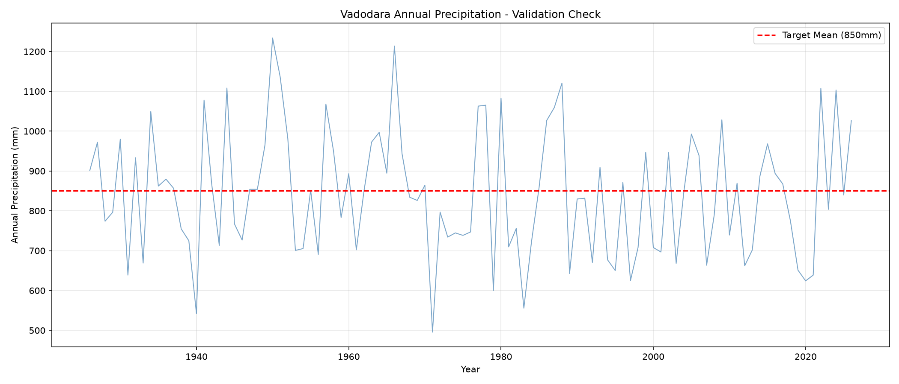
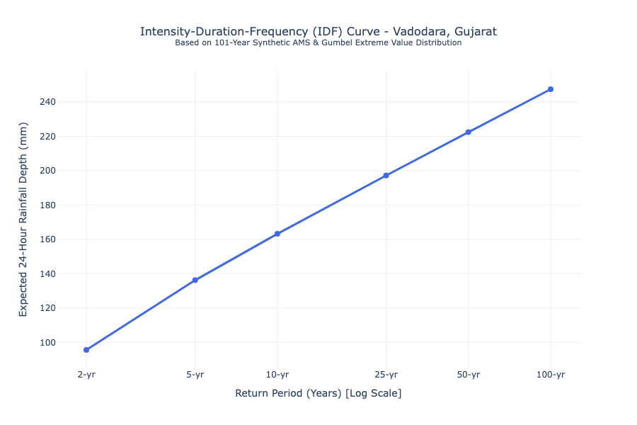

# Automated Urban Hydrology and IDF Curve Pipeline


## Project Overview
An end-to-end data engineering and hydrological analysis pipeline that generates statistically realistic precipitation data, validates it against physical constraints, and computes industry-standard Intensity-Duration-Frequency (IDF) curves for urban drainage design. 

This project is calibrated specifically for Vadodara, Gujarat, addressing the real-world engineering challenge of cloudburst-induced urban flooding in the Vishwamitri river basin.

## Business and Engineering Impact
* **Bridging the Gap:** Translates raw, noisy meteorological data into actionable engineering design parameters, such as return periods, rainfall depth, and intensity.
* **Climate Resilience:** Uses Extreme Value Theory (Gumbel Distribution) to accurately model tail-risk events, specifically 50-year and 100-year storms, which traditional averages often miss.
* **Automation and Efficiency:** Reduces the time required to generate an IDF curve from days of manual statistical software work to seconds via a reproducible Python pipeline.

## Tech Stack
* **Data Processing:** pandas, numpy
* **Statistical Modeling:** scipy.stats (Gamma and Generalized Pareto for synthetic generation, Gumbel Extreme Value Type I for IDF fitting)
* **Visualization:** plotly (Interactive HTML dashboards), matplotlib (Static validation plots)
* **Workflow:** Git, GitHub, Virtual Environments

## Key Deliverables and Methodology

### 1. Synthetic Data Generation and Validation
Before any modeling begins, the pipeline generates over 100 years of daily rainfall data calibrated to Vadodara's semi-arid monsoon profile (targeting an 850mm annual mean). 

To ensure the data is physically realistic, an automated validation framework checks the output against known climatological constraints.

**Validation Output:**

*The plot above confirms the synthetic data maintains a realistic annual mean of 842mm, with natural year-to-year variability and extreme cloudburst events capped at a physically realistic 280mm.*

### 2. IDF Curve Statistical Engine
Once validated, the pipeline extracts the Annual Maximum Series (the single highest 24-hour rainfall event for each year) and fits a Gumbel Extreme Value Type I distribution. This allows us to mathematically extrapolate and predict rare events.

**Sample Output: 24-Hour IDF Curve (Vadodara)**

*The curve above shows the expected 24-hour rainfall depth for various return periods. For example, a 100-Year Storm is calculated to have an expected depth of 247.4 mm, with an average intensity of 10.31 mm/hr.*

## How to Run This Project
1. Clone the repository and navigate to the folder:
   ```bash
   git clone https://github.com/NateNapier/automated-urban-hydrology-pipeline.git
   cd automated-urban-hydrology-pipeline